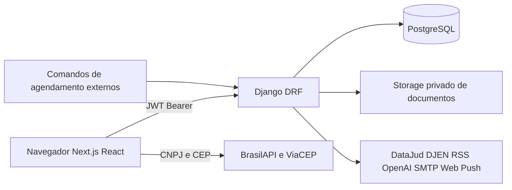

# Arquitetura, API e operação do LexNexo

Revisão de 27/10/2026; commit base
`8b41a295e0d7be677600295eb56537bb2c0f871e`, com correções locais descritas no
[relatório](RELATORIO_VALIDACAO.md). Fontes: core/settings.py, models.py,
serializers.py, urls.py, views, next.config.mjs e src/services/api.js.

## Arquitetura observada



Na Vercel, o frontend usa `/api` na mesma origem, com rewrite para
NEXT_PUBLIC_API_URL. Fora dos domínios vercel.app, usa diretamente essa URL.
Ela é incorporada durante o build. Next.js 16.4.2/React 19.2.4 compõem a
interface; Django 6.0.8/DRF 3.18.2 expõem a API. Não há Celery ou n8n
implementado. A automação depende de comandos disparados por agendador externo.

## Banco e segregação

Existem 27 modelos e 37 migrations de advocacia, listados no
[inventário](INVENTARIO_E_CASOS.md). Escritório relaciona usuários, clientes,
advogados, processos, contratos e registros operacionais. Processo relaciona
movimentações, documentos, agenda, tarefas, horas e despesas. Contrato tem
relação um-para-um com processo e várias parcelas. Rascunho é privado do
usuário e escritório. SuperAdmin é separado do Usuario de escritório.

EscritorioScopedMixin filtra consultas; serializers verificam os objetos
relacionados; permissões por perfil são aplicadas na API. Sigilo alcança o
processo e seus dependentes. A ficha consolidada agora também verifica a área
financeira, horas e despesas antes de serializar cada bloco. A matriz de
perfis está em `backend/advocacia/permissoes.py` e é entregue à interface.

Fotos novas são convertidas em WebP pequeno por PersistentPhotoStorage e
persistidas em FotoPersistente no PostgreSQL; referências antigas podem
recorrer ao storage anterior. Documentos usam filesystem local ou S3 privado.
Não publique MEDIA_ROOT diretamente. Downloads/fotos passam por API com
autenticação e escopo. A migration 0037 habilita RLS na tabela de fotos e
revoga permissões dos papéis anon/authenticated, quando existem. Isso não
comprova as políticas atuais das demais tabelas do Supabase publicado.

## Contrato da API

O catálogo completo de **102 paths e 166 operações** está no inventário.
Swagger/ReDoc/schema existem apenas quando API_DOCS_PUBLICAS=True. Para gerar
um schema sem consultar produção:

```bash
cd backend
ambiente/bin/python manage.py spectacular --validate --fail-on-warn \
  --settings=core.settings_auditoria --file /tmp/lexnexo-openapi.yml
```

Login recebe `{email, senha}` e devolve `{access, refresh, usuario}`, ou desafio
de segunda etapa. Conclua TOTP em `/api/login/2fa/`. Demais chamadas enviam
`Authorization: Bearer <access>`. Refresh em `/api/token/refresh/` rotaciona e
revoga o token utilizado; logout em `/api/logout/` retorna 200 e revoga refresh.
Access já emitido pode durar até 30 minutos. Desativação de conta/escritório
e troca de session_version impedem autenticação posterior desses tokens.

Exemplos de payloads sintéticos, sem tokens reais:

```json
{"nome":"Cliente Fictício","cpf":"00000000001","email":"auditoria@example.com","telefone":"11000000000","endereco":"Endereço fictício"}
```

`POST /api/clientes/` cria cliente. O escritório vem da conta autenticada.
`POST /api/processos/` exige cliente e advogado do mesmo escritório, além de
numero_processo, titulo e descricao. `POST /api/agenda/` aceita processo
opcional, titulo, descricao, tipo, prioridade e data_evento ISO com fuso.
`PATCH /api/<recurso>/<id>/` altera campos permitidos. Não enviar escritorio,
perfil ou proprietário como mecanismo para obter acesso adicional.

Respostas usuais: 200 leitura/alteração/ações, 201 criação, 204 exclusão,
400 validação, 401 sem sessão válida, 403 ação não permitida, 404 recurso
ausente ou fora do escopo, 429 limite, 502/503 integração indisponível quando
previsto. Nem todo endpoint implementa todos esses códigos. Listagens usam
count/next/previous/results; feriados locais e ações específicas podem usar
listas/objetos próprios. Não descartar next silenciosamente no cliente.

## Manual dos fluxos verificados

1. Entre como membro do escritório. Menus e ações dependem do perfil; a API
   mantém a proteção mesmo quando alguém chama uma URL diretamente.
2. Cadastre cliente em Clientes › Novo; use dados sintéticos na demonstração.
   Depois busque/edite o cadastro. Inativação, exclusão e anonimização têm
   efeitos distintos; não utilizar essas operações nos registros preservados.
3. Em Processos › Novo, informe identificação, cliente e advogado. A ficha
   reúne movimentações, agenda, tarefas, anexos e blocos financeiros permitidos.
   Segredo de justiça restringe acesso a administrador e advogado responsável.
4. Em Agenda › Novo, escolha Compromisso ou Prazo. A calculadora auxilia a
   contagem e considera feriados/recesso; o profissional deve conferir a regra
   aplicável. Leitura de intimação, conferência de prazo e cumprimento são
   estados diferentes. Exporte .ics em Sincronizar sem divulgar o feed privado.
5. Em Tarefas, defina responsável, prioridade, prazo e vínculo opcional.
   Use lista ou quadro para mudar a situação; a tarefa concluída vai ao histórico.
6. Em Documentos, escolha o processo e arquivo aceito de até 10 MB. A abertura
   autenticada foi testada na API local; sua visualização publicada ficou
   pendente no navegador integrado. Não confundir envio confirmado com download.
7. Contratos geram parcelas; o modo PIX de teste não movimenta dinheiro e não
   dá baixa real. Não usar Marcar como pago para simular uma transação bancária.
8. Horas e custos registram duração, valor/hora, despesas e reembolso. Datas
   iniciais e vencimentos novos usam o dia local após a correção de fuso.
9. Modelos substituem apenas variáveis de catálogo fechado. Revise o preview
   antes de imprimir. Texto é tratado como dado; não é executado como código.
10. IA e resumo ao cliente usam controles de plano/perfil. O advogado revisa
    conteúdo e destinatário antes de enviar; não enviar documentos reais na demo.

O [registro prático](TESTES_PRATICOS.md) descreve os dados que ficaram na conta.
Os testes de agente não substituem o protocolo com participantes humanos.

## Integrações e nomes de variáveis

| Área | Variáveis principais | Situação nesta auditoria |
|---|---|---|
| Django | SECRET_KEY, DEBUG, ALLOWED_HOSTS, FRONTEND_URL, API_DOCS_PUBLICAS | Checks locais; produção administrativa BLOQUEADO |
| Banco | DB_NAME, DB_USER, DB_PASSWORD, DB_HOST, DB_PORT, DB_SSLMODE, DB_CONN_MAX_AGE | Somente PostgreSQL exclusivo local |
| Frontend | NEXT_PUBLIC_API_URL, NEXT_OUTPUT | npm ci/lint/Jest/build/E2E reais |
| Arquivos | MEDIA_STORAGE, MEDIA_S3_BUCKET, MEDIA_S3_ENDPOINT_URL, MEDIA_S3_REGION_NAME, MEDIA_S3_ACCESS_KEY_ID, MEDIA_S3_SECRET_ACCESS_KEY | Filesystem e fotos locais; ACL/bucket remoto BLOQUEADO |
| IA/CNJ | OPENAI_API_KEY, OPENAI_MODEL, DATAJUD_API_KEY, DATAJUD_URL_BASE, DJEN_API_URL | Mocks, falhas e fallback; chamadas pagas não executadas |
| E-mail/push | EMAIL_HOST, EMAIL_PORT, EMAIL_HOST_USER, EMAIL_HOST_PASSWORD, EMAIL_USE_TLS, DEFAULT_FROM_EMAIL, VAPID_PUBLIC_KEY, VAPID_PRIVATE_KEY, VAPID_EMAIL | Local em memória/mocks; entrega externa BLOQUEADO |
| Comercial/demo | CONTATO_COMERCIAL, DEMO_PASSWORD, LIMITES_DESLIGADOS | Dados sintéticos locais; não usar limite desligado ou senha de demo em produção |

LEXNEXO_ENV_FILE e o alias legado LEXOFFICE_ENV_FILE controlam a leitura do
arquivo de ambiente. A configuração de auditoria força /dev/null e conexão
loopback. AUDIT_DB_PORT/USER/PASSWORD e AUDIT_FRONTEND_PORT são exclusivos dos
settings de teste. Nunca publicar valores reais dessas variáveis.

## Deploy, backup e recuperação

O [guia do piloto](../deploy-piloto.md) e render.yaml descrevem o deploy.
O start.sh aplica migrations e inicia Gunicorn com um worker/quatro threads.
Antes de publicar correções: revisar diff, preparar backup separado do banco
e dos documentos, confirmar possibilidade de restauração em staging, gerar
build com a URL correta e conferir health/login/CRUD/sigilo/upload.

Rollback recomendado: restaurar a versão de aplicação anterior somente se
compatível com o schema atual. Operações de dados das migrations 0002, 0031
e 0037 têm reversão noop e não recompõem automaticamente os dados anteriores.
Não executar migrate para trás como substituto de backup. Se houver perda de
dados, restaurar cópia validada num ambiente separado, conferir integridade
e arquivos e só então planejar a troca do ambiente. Esse procedimento é uma
recomendação operacional; restauração real não foi executada nesta auditoria.

CI existente: Python 3.12, Node 22, PostgreSQL 16 em serviço efêmero, testes,
schema, check --deploy, auditoria de dependências, lint/build e Playwright.
A execução remota do pipeline não foi consultada; a alteração local anterior
em `.github/workflows/ci.yml` foi preservada. A rodada local usou Python
3.14.7/PostgreSQL 18.6; equivalência exata com o CI e serviços publicados
continua uma limitação explícita.
