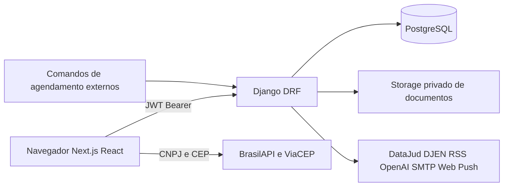

# Arquitetura, API e operação do LexNexo

<!-- auditoria-2026-11-09:inicio -->

## Auditoria final de 09/11/2026 — TDS-2026-038

**APTO COM RESSALVAS.** Referência final: **885 testes** — 550 Django, 290 Jest e
45 Playwright (44 cenários de navegador, três deles em viewport móvel, e um
HTTP/proxy sem UI). Rodadas e repetições entre navegadores não se somam.
Cobertura de linhas: **91,85% backend e 38,03% frontend**. A meta frontend de
70% permanece pendente; não foram excluídos componentes para elevar a medida.

Sete achados adicionais, A24–A30, foram corrigidos e retestados: consistência
contrato/parcelas, estorno e auditoria, entradas malformadas, cálculo de prazo,
vínculo cliente/processo no modelo, erro de baixa e foco/Escape em Configurações.
A aplicação `98ff6bf` foi publicada na Vercel e no Render. O CI dessa versão
aprovou 884 casos; o CI complementar [42620912216](https://github.com/guimunhoz13/TCCrepository/actions/runs/42620912216) aprovou 885 após acrescentar o caso PWA.

Na conta publicada: **37 APROVADO e 1 BLOQUEADO em 38 verificações**, com **15 novos
registros principais mantidos**. Cliente e processo foram criados pela interface;
os demais lançamentos tiveram conferência autenticada e confirmação visual na ficha.
Nenhum pagamento real, exclusão ou anonimização foi feito em produção. Cinco
anexos conservaram bytes/SHA-256 e os IDs anteriores de 13 famílias foram preservados.
A inspeção visual da nova aba PDF foi bloqueada pela política de URL blob da
ferramenta; a verificação binária da API tem evidência independente.

Fontes: [execuções](evidencias/2026-11-09/execucoes.json),
[catálogo](evidencias/2026-11-09/inventario-e-casos.md),
[práticos](evidencias/2026-11-09/praticos.json),
[publicação](PUBLICACAO-2026-11-09.md) e [métricas únicas](evidencias/metricas-atuais.json).
A API exige objeto JSON no corpo; listas, números ou texto na raiz retornam
400. Uploads continuam aceitando multipart. Validam-se tipos, limites de campos,
IDs positivos de 64 bits e fuso IANA. Prazo exige inteiro de 1 a 10.000 dias;
valores fracionários/booleanos e datas fora do intervalo retornam 400.

Após emissão de parcelas, mudanças incompatíveis de processo, total, forma ou
quantidade são recusadas. Metadados permitidos continuam editáveis. A mudança de
pago para outro status limpa pago_em e registra auditoria. Modelos não combinam
cliente diferente do cliente do processo. Em Configurações, Tab fica no modal e
Escape respeita a confirmação de alterações. O PWA exibe Sem conexão sem guardar
respostas de API; não oferece escrita offline de dados do escritório.

Modo S3 confirmado no Render em 09/11; esquema PostgreSQL compartilhado com vínculos
por escritório e escopo na API. Não se afirma esquema por escritório nem RLS
completa. C1/C2/C3 e implantação permanecem separados no relatório técnico.

As seções datadas anteriores são histórico e não substituem esta referência.

<!-- auditoria-2026-11-09:fim -->

<!-- auditoria-2026-11-05:inicio -->

## Referência atual de 05/11/2026

Grupo confirmado: **TDS-2026-038**. A rodada local final possui **863 testes
aprovados** (536 Django, 288 Jest, 39 Playwright).
Consulte o [relatório de validação](RELATORIO_VALIDACAO.md), a
[fonte única de métricas](evidencias/metricas-atuais.json) e o
[catálogo atualizado](evidencias/2026-11-05/inventario-e-casos.md).
Abertura de documentos/relatórios e MIME PDF corrigidos localmente; publicação
aguarda reconexão ao Render e conferência do armazenamento. Vídeo a gravar pelos
integrantes. As seções abaixo conservam as datas e resultados históricos.

<!-- auditoria-2026-11-05:fim -->

<!-- auditoria-2026-11-04:inicio -->

## Revisão operacional de 04 de novembro de 2026

Esta revisão complementa o manual abaixo e a conferência de 03/11.
Contratos novos usam transação única para contrato/parcelas e exigem pelo
menos um centavo por parcela. A divisão preserva o total sem parcela zero;
os contratos antigos não são recalculados. Publicação da API deve ser
confirmada no registro de implantação.

O Assistente IA no Gratuito informa o plano Profissional e não monta o chat.
Em erro ao consultar o plano, permite tentar novamente sem liberar o recurso.
Pesquisar na ajuda ou busca global não representa cadastro não salvo; fechar
a busca não deve pedir descarte. A edição de cadastro segue protegida.
Fotos usam rota autenticada sem barra final; a regra específica do proxy não
altera os nomes de arquivo. Não expor MEDIA_ROOT publicamente.

O provedor de IA no código é OpenAI; OPENAI_MODEL seleciona o modelo e o
padrão do código é gpt-4o-mini, sem comprovação do valor ativo remoto.
O esquema de banco é compartilhado com relações a Escritorio; isolamento
aplicado na API, serializers e sigilo, sem esquemas separados por cliente.
A RLS específica de fotos não comprova políticas completas do Supabase.

O guia PDF atualizado conserva passos e capturas históricas identificados,
acrescenta resultados e exemplos de novembro e usa a mesma tabela datada do
RT. C1, C2 e C3 estão nos fontes de diagramas; implantação física e sequência
TOTP/prazo têm arquivos separados. Em falha de CEP/CNPJ, preencher manualmente;
em falha de CNJ, consultar o canal oficial e registrar movimento/prazo manual
com conferência. Sem IA, usar o fallback disponível e revisão humana.

[Resultados atuais](RELATORIO_VALIDACAO.md), [publicação](PUBLICACAO-2026-11-04.md),
[resposta ao parecer e roteiro de vídeo](../tcc/RESPOSTA_AO_PARECER-2026-11-04.md).
Afirmações de que o CI não foi consultado nas seções antigas são históricas.

<!-- auditoria-2026-11-04:fim -->

Revisão de 27/10/2026; commit base
`8b41a295e0d7be677600295eb56537bb2c0f871e`, com correções locais descritas no
[relatório](RELATORIO_VALIDACAO.md). Fontes: core/settings.py, models.py,
serializers.py, urls.py, views, next.config.mjs e src/services/api.js.

## Arquitetura observada



Na Vercel, o frontend usa `/api` na mesma origem, com rewrite para
NEXT_PUBLIC_API_URL. Fora dos domínios vercel.app, usa diretamente essa URL.
Ela é incorporada durante o build. Next.js 16.4.2/React 19.2.4 compõem a
interface; Django 6.0.8/DRF 3.18.2 expõem a API. Não há Celery ou n8n
implementado. A automação depende de comandos disparados por agendador externo.

## Banco e segregação

Existem 27 modelos e 37 migrations de advocacia, listados no
[inventário](INVENTARIO_E_CASOS.md). Escritório relaciona usuários, clientes,
advogados, processos, contratos e registros operacionais. Processo relaciona
movimentações, documentos, agenda, tarefas, horas e despesas. Contrato tem
relação um-para-um com processo e várias parcelas. Rascunho é privado do
usuário e escritório. SuperAdmin é separado do Usuario de escritório.

EscritorioScopedMixin filtra consultas; serializers verificam os objetos
relacionados; permissões por perfil são aplicadas na API. Sigilo alcança o
processo e seus dependentes. A ficha consolidada agora também verifica a área
financeira, horas e despesas antes de serializar cada bloco. A matriz de
perfis está em `backend/advocacia/permissoes.py` e é entregue à interface.

Fotos novas são convertidas em WebP pequeno por PersistentPhotoStorage e
persistidas em FotoPersistente no PostgreSQL; referências antigas podem
recorrer ao storage anterior. Documentos usam filesystem local ou S3 privado.
Não publique MEDIA_ROOT diretamente. Downloads/fotos passam por API com
autenticação e escopo. A migration 0037 habilita RLS na tabela de fotos e
revoga permissões dos papéis anon/authenticated, quando existem. Isso não
comprova as políticas atuais das demais tabelas do Supabase publicado.

## Contrato da API

O catálogo completo de **102 paths e 166 operações** está no inventário.
Swagger/ReDoc/schema existem apenas quando API_DOCS_PUBLICAS=True. Para gerar
um schema sem consultar produção:

```bash
cd backend
ambiente/bin/python manage.py spectacular --validate --fail-on-warn \
  --settings=core.settings_auditoria --file /tmp/lexnexo-openapi.yml
```

Login recebe `{email, senha}` e devolve `{access, refresh, usuario}`, ou desafio
de segunda etapa. Conclua TOTP em `/api/login/2fa/`. Demais chamadas enviam
`Authorization: Bearer <access>`. Refresh em `/api/token/refresh/` rotaciona e
revoga o token utilizado; logout em `/api/logout/` retorna 200 e revoga refresh.
Access já emitido pode durar até 30 minutos. Desativação de conta/escritório
e troca de session_version impedem autenticação posterior desses tokens.

Exemplos de payloads sintéticos, sem tokens reais:

```json
{"nome":"Cliente Fictício","cpf":"00000000001","email":"auditoria@example.com","telefone":"11000000000","endereco":"Endereço fictício"}
```

`POST /api/clientes/` cria cliente. O escritório vem da conta autenticada.
`POST /api/processos/` exige cliente e advogado do mesmo escritório, além de
numero_processo, titulo e descricao. `POST /api/agenda/` aceita processo
opcional, titulo, descricao, tipo, prioridade e data_evento ISO com fuso.
`PATCH /api/<recurso>/<id>/` altera campos permitidos. Não enviar escritorio,
perfil ou proprietário como mecanismo para obter acesso adicional.

Respostas usuais: 200 leitura/alteração/ações, 201 criação, 204 exclusão,
400 validação, 401 sem sessão válida, 403 ação não permitida, 404 recurso
ausente ou fora do escopo, 429 limite, 502/503 integração indisponível quando
previsto. Nem todo endpoint implementa todos esses códigos. Listagens usam
count/next/previous/results; feriados locais e ações específicas podem usar
listas/objetos próprios. Não descartar next silenciosamente no cliente.

## Manual dos fluxos verificados

1. Entre como membro do escritório. Menus e ações dependem do perfil; a API
   mantém a proteção mesmo quando alguém chama uma URL diretamente.
2. Cadastre cliente em Clientes › Novo; use dados sintéticos na demonstração.
   Depois busque/edite o cadastro. Inativação, exclusão e anonimização têm
   efeitos distintos; não utilizar essas operações nos registros preservados.
3. Em Processos › Novo, informe identificação, cliente e advogado. A ficha
   reúne movimentações, agenda, tarefas, anexos e blocos financeiros permitidos.
   Segredo de justiça restringe acesso a administrador e advogado responsável.
4. Em Agenda › Novo, escolha Compromisso ou Prazo. A calculadora auxilia a
   contagem e considera feriados/recesso; o profissional deve conferir a regra
   aplicável. Leitura de intimação, conferência de prazo e cumprimento são
   estados diferentes. Exporte .ics em Sincronizar sem divulgar o feed privado.
5. Em Tarefas, defina responsável, prioridade, prazo e vínculo opcional.
   Use lista ou quadro para mudar a situação; a tarefa concluída vai ao histórico.
6. Em Documentos, escolha o processo e arquivo aceito de até 10 MB. A abertura
   autenticada foi testada na API local; sua visualização publicada ficou
   pendente no navegador integrado. Não confundir envio confirmado com download.
7. Contratos geram parcelas; o modo PIX de teste não movimenta dinheiro e não
   dá baixa real. Não usar Marcar como pago para simular uma transação bancária.
8. Horas e custos registram duração, valor/hora, despesas e reembolso. Datas
   iniciais e vencimentos novos usam o dia local após a correção de fuso.
9. Modelos substituem apenas variáveis de catálogo fechado. Revise o preview
   antes de imprimir. Texto é tratado como dado; não é executado como código.
10. IA e resumo ao cliente usam controles de plano/perfil. O advogado revisa
    conteúdo e destinatário antes de enviar; não enviar documentos reais na demo.

O [registro prático](TESTES_PRATICOS.md) descreve os dados que ficaram na conta.
Os testes de agente não substituem o protocolo com participantes humanos.

## Integrações e nomes de variáveis

| Área | Variáveis principais | Situação nesta auditoria |
|---|---|---|
| Django | SECRET_KEY, DEBUG, ALLOWED_HOSTS, FRONTEND_URL, API_DOCS_PUBLICAS | Checks locais; produção administrativa BLOQUEADO |
| Banco | DB_NAME, DB_USER, DB_PASSWORD, DB_HOST, DB_PORT, DB_SSLMODE, DB_CONN_MAX_AGE | Somente PostgreSQL exclusivo local |
| Frontend | NEXT_PUBLIC_API_URL, NEXT_OUTPUT | npm ci/lint/Jest/build/E2E reais |
| Arquivos | MEDIA_STORAGE, MEDIA_S3_BUCKET, MEDIA_S3_ENDPOINT_URL, MEDIA_S3_REGION_NAME, MEDIA_S3_ACCESS_KEY_ID, MEDIA_S3_SECRET_ACCESS_KEY | Filesystem e fotos locais; ACL/bucket remoto BLOQUEADO |
| IA/CNJ | OPENAI_API_KEY, OPENAI_MODEL, DATAJUD_API_KEY, DATAJUD_URL_BASE, DJEN_API_URL | Mocks, falhas e fallback; chamadas pagas não executadas |
| E-mail/push | EMAIL_HOST, EMAIL_PORT, EMAIL_HOST_USER, EMAIL_HOST_PASSWORD, EMAIL_USE_TLS, DEFAULT_FROM_EMAIL, VAPID_PUBLIC_KEY, VAPID_PRIVATE_KEY, VAPID_EMAIL | Local em memória/mocks; entrega externa BLOQUEADO |
| Comercial/demo | CONTATO_COMERCIAL, DEMO_PASSWORD, LIMITES_DESLIGADOS | Dados sintéticos locais; não usar limite desligado ou senha de demo em produção |

LEXNEXO_ENV_FILE e o alias legado LEXOFFICE_ENV_FILE controlam a leitura do
arquivo de ambiente. A configuração de auditoria força /dev/null e conexão
loopback. AUDIT_DB_PORT/USER/PASSWORD e AUDIT_FRONTEND_PORT são exclusivos dos
settings de teste. Nunca publicar valores reais dessas variáveis.

## Deploy, backup e recuperação

O [guia do piloto](../deploy-piloto.md) e render.yaml descrevem o deploy.
O start.sh aplica migrations e inicia Gunicorn com um worker/quatro threads.
Antes de publicar correções: revisar diff, preparar backup separado do banco
e dos documentos, confirmar possibilidade de restauração em staging, gerar
build com a URL correta e conferir health/login/CRUD/sigilo/upload.

Rollback recomendado: restaurar a versão de aplicação anterior somente se
compatível com o schema atual. Operações de dados das migrations 0002, 0031
e 0037 têm reversão noop e não recompõem automaticamente os dados anteriores.
Não executar migrate para trás como substituto de backup. Se houver perda de
dados, restaurar cópia validada num ambiente separado, conferir integridade
e arquivos e só então planejar a troca do ambiente. Esse procedimento é uma
recomendação operacional; restauração real não foi executada nesta auditoria.

CI existente: Python 3.12, Node 22, PostgreSQL 16 em serviço efêmero, testes,
schema, check --deploy, auditoria de dependências, lint/build e Playwright.
A execução remota do pipeline não foi consultada; a alteração local anterior
em `.github/workflows/ci.yml` foi preservada. A rodada local usou Python
3.14.7/PostgreSQL 18.6; equivalência exata com o CI e serviços publicados
continua uma limitação explícita.

## Conferência prática de 03/11/2026

Os novos registros usam o prefixo **AUDITORIA TCC 20261103** e permanecem
na conta publicada: cliente Gama, processos Gama e Delta, dois prazos, duas
audiências, tarefa, contrato com três parcelas, horas, despesa, documento,
modelo e movimentação. A suspensão fictícia de 13/11 foi limitada à
abrangência AUDITORIA TCC 20261103; não representa um feriado real.

Para repetir a demonstração com os dados preservados:

1. Use a busca global `20261103`. Os resultados abrem o cadastro ou a ficha
   correspondente, separados por área.
2. Abra `AUDITORIA-TCC-20261103-01`: a ficha reúne os quatro eventos, tarefa,
   anexo, movimentação e quadro financeiro. O contrato de R$ 100,01 continua
   pendente; a simulação PIX não quitou nenhuma parcela.
3. Em Compromissos, confira 16/11 às 14h30 e 25/11 às 9h; na Agenda, os
   prazos de 10/11 às 18h e 24/11 às 16h. A calculadora excluiu 03/11 e
   contou cinco dias úteis até 10/11. Não substitui conferência jurídica.
4. Em Modelos de documento, escolha Declaração Gama e o processo Gama.
   O preview substitui cliente, número e data. Revise antes de usar.
5. Em Documentos, o anexo Gama é um PDF fictício. O download autenticado
   foi comparado byte a byte com o original. A abertura por nova aba no
   navegador integrado não foi comprovada, nem a impressão do relatório.
6. O apontamento sintético de 1h15 a R$ 120/h resulta em R$ 150,00. Ele
   conservou a data 27/10 restaurada do rascunho; a despesa de R$ 23,45 é
   de 03/11. Conferir a data restaurada antes de salvar novos lançamentos.

A auditoria corrigiu a criação atômica de contratos e a distribuição de
centavos para novas parcelas. Contratos já existentes não são recalculados.
Também corrigiu o acesso visual ao assistente conforme o recurso do plano
e o aviso de descarte indevido ao fechar buscas. As versões publicadas e
os limites de reteste estão no relatório de validação e nas evidências
datadas; um commit no GitHub não comprova implantação da API.

A leitura de Conta, Escritório, Notificações, Aparência, Dados, Relatórios,
Auditoria, Faturamento, Advogados e Contato não equivale a executar todas
as ações administrativas. Senhas, perfis, pagamento real, desativação,
exclusões e anonimização não foram alterados na conta publicada. Os testes
negativos e destrutivos correspondentes ocorreram apenas no banco local.
